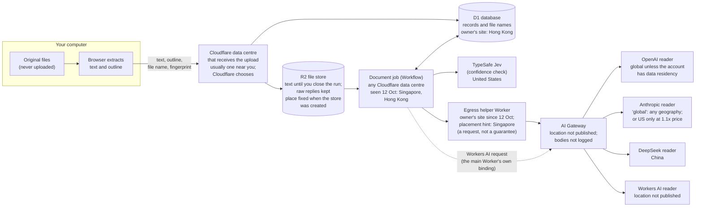

# Where document text is processed and stored, and why it can be outside your country

*Written 12 October 2026. Every platform and vendor fact below was read from the provider's own documentation on 12 October 2026; each source is listed at the end with the date the page says it was last updated. Nothing in the system was changed to write this page. Updated later the same day, after the owner switched on a placed helper for the AI Gateway calls (DECISIONS 156, addendum of 12 October 2026); the places that mention it say so.*

**Who this is for.** A compliance officer, a data-protection lead or a manager who has to decide whether documents may be put through Doc Classifier, and the engineer who has to answer their questions. The first half is in plain words. The second half ([Engineering detail](#engineering-detail)) gives the exact settings and sources.

## The short answer

- **Your original files never leave your computer.** The browser reads them where they are, and the folders at the end are built from them on your computer. That promise is unchanged.
- **The extracted text does leave, and it can be handled and stored outside your country.** The text, the outline (headings and table headers), the file name and a fingerprint (a short code computed from the file) go to Cloudflare, and from there the text goes to two AI services.
- **Cloudflare, not this app, picks the building the work happens in.** Cloudflare runs the app in data centres around the world and chooses, for each piece of work, which one does it. On 12 October 2026 the owner's site handled documents in Singapore on some runs and in Hong Kong on others, and its database lives in Hong Kong. The app was not asked and could not choose. Since later that day, the owner's site makes the calls to the OpenAI, Anthropic and DeepSeek readers from a small helper placed near Singapore; that is a request to Cloudflare, not a guarantee, and the document's job itself, the TypeSafe call and the Workers AI reader still run wherever Cloudflare puts them.
- **The AI services have their own locations.** TypeSafe (the confidence check) is hosted in the United States. Anthropic's default lets the model run "in any available geography". OpenAI processes in-region only for eligible customers who ask for it. DeepSeek processes in China.
- **So: if your organisation must keep document processing inside one country, the setup as built does not guarantee it,** neither on the owner's hosted site nor on a copy deployed in the ordinary way. Some parts can be pinned with settings, some only with Cloudflare's Enterprise contract, and some not at all today. The details are [below](#if-your-organisation-must-process-in-country).

## Words used on this page

| Word | Meaning here |
|---|---|
| **Data centre** | A building full of Cloudflare's servers. Cloudflare names each one by the nearest airport's three-letter code: SIN is Singapore, HKG is Hong Kong. |
| **Processed** | Held in a computer's working memory while something is done with it, such as reading it or sending it on. It is not kept afterwards. |
| **Stored** | Written to disk and kept until it is deleted. |
| **Worker** | The app's program on Cloudflare. It answers the web page. |
| **Workflow** | The durable job Cloudflare runs for each document. It sends the text to the two AI services and records their answers. "Durable" means that if something fails part-way, the job carries on from its last saved step. |
| **D1** | Cloudflare's database. It holds the records: runs, file names, fingerprints, outcomes, costs. |
| **R2** | Cloudflare's file store. It holds the uploaded text until the run is closed, and the AI services' raw replies. |
| **AI Gateway** | A Cloudflare relay that every call to OpenAI, Anthropic, DeepSeek and Workers AI passes through. |
| **Inference** | The AI model reading the text and writing its answer. |
| **Jurisdiction** | A Cloudflare setting, chosen when a database or file store is created, that Cloudflare guarantees will keep its data inside a region. Cloudflare offers only three: the European Union (`eu`), the United States (`us`) and FedRAMP (`fedramp`, US government-grade data centres). |
| **Location hint** | A request to Cloudflare to put something near a region. Cloudflare calls hints "best effort and not a guarantee". |
| **Data Localization Suite** | Cloudflare's paid Enterprise add-on for data residency. Its part called **Regional Services** limits which data centres may decrypt and process traffic. |

## Where the text goes, step by step

The same journey as a table. "Who chooses" says who decides the location today.

| # | Step | What is there | Where it can be | Who chooses | Can it be held to one country? |
|---|---|---|---|---|---|
| 1 | Your computer | Original files, extraction | Your computer | You | Yes. Nothing leaves except what step 2 lists. |
| 2 | Upload to Cloudflare | Text, outline, file name, fingerprint, in memory | The Cloudflare data centre that receives your connection, normally one near you | Cloudflare's network | Only with Enterprise Regional Services. |
| 3 | R2 file store | The text until the run is closed; the AI services' raw replies (which can quote the document) for good | Fixed when the store was created; by default near whoever created it | Whoever created the store | Only to the EU, the US or FedRAMP, and only when the store is first created. |
| 4 | D1 database | Records: run settings, file names, fingerprints, outcomes, rule fired, timings, costs | One main copy, fixed when the database was created; owner's site: Hong Kong | Whoever created the database | Only to the EU, the US or FedRAMP, and only when the database is first created. |
| 5 | Document job (Workflow) | The text, in memory, while it is sent to the AI services | Any Cloudflare data centre; seen in Singapore and Hong Kong | Cloudflare | **No.** Cloudflare offers no location or jurisdiction setting for Workflows. |
| 6 | AI Gateway | The request and the reply, in transit. The gateway logs counts and timings, not the text. | Not published | Cloudflare | **No.** Regional Services does not support AI Gateway. |
| 7 | TypeSafe (Jev) | The text, for the confidence check | United States | TypeSafe | Only if your country is the US. No other region is published. |
| 8 | OpenAI | The text, for the reader | Global by default. Some regions on request (see below) | OpenAI and your OpenAI account | Inference in the US, Europe or the UAE, for eligible customers who ask OpenAI. Storage only in seven more countries. |
| 9 | Anthropic | The text, for the reader | "global": any geography Anthropic uses; or US only | Anthropic and your Anthropic workspace | Only if your country is the US, at 1.1 times the price. The site would need a code change to accept it. |
| 10 | DeepSeek | The text, for the reader (experimental) | China | DeepSeek | No. |
| 11 | Workers AI | The text, for the reader (experimental) | Not published | Cloudflare | Not published; Regional Services does not support Workers AI. |

Since 12 October 2026 the owner's site makes the OpenAI, Anthropic and DeepSeek requests of step 6 from a small helper Worker with a placement hint for Singapore (`aws:ap-southeast-1`; DECISIONS 156, addendum of 12 October 2026), so those calls meet the gateway from there when Cloudflare honours the hint. A hint is a request, not a guarantee. The document job still holds the text first (step 5), and the TypeSafe call and the Workers AI request still leave from the job's own data centre.

When a person closes a run, the uploaded text and outline are deleted from R2; nothing is deleted on a timer. The records in D1 and the raw replies in R2 are kept, and the raw replies can quote passages from your documents (DESIGN.md §5.8; [DECISIONS 143](../DECISIONS.md)).

## A real example: 12 October 2026

These observations come from the owner's own site. No document text or secret is shown here.

- **The database is in Hong Kong.** Timings read on 12 October from a run of 11 October showed that each round trip from a document job to the database's main copy took about 150 milliseconds, and the measurement records the main copy as being in Hong Kong (HKG). The records do not say whether a location hint was given when it was created; without one, a new D1 database goes "close to where you issued the request to create a database" (D1 data location page).
- **The document jobs ran in different countries on different runs.** Every reply Cloudflare carries is stamped with a "Ray ID" whose last three letters are the code of the data centre that processed the request (Cloudflare HTTP headers page). On 12 October:
  - Claude (Anthropic) calls that succeeded carried **SIN**: they left Cloudflare from **Singapore**.
  - Claude calls that Anthropic's network refused carried **HKG**: they left from **Hong Kong**. The refusal was HTTP 403 "Request not allowed", and it carried no Anthropic request id, so Anthropic's model never saw it. Hong Kong is not on Anthropic's list of supported countries and regions, which says "any country or region not listed is unsupported" (Anthropic supported countries page). The refusal is consistent with that, though Anthropic did not say why.
  - TypeSafe calls were seen leaving from **SIN** as well.
- **The app did not choose either place.** Nothing in the app or its settings named Singapore or Hong Kong when these calls were made. Cloudflare decided where each document's job ran, its choice changed between runs, and the app had no setting that could have stopped it. (The placed helper described under [Engineering detail](#engineering-detail) was switched on later the same day; a one-paper proof run through it was answered from Singapore.)

The practical effect went beyond compliance: the documents whose jobs ran in Hong Kong could not be read by Claude, and they were set aside as "could not process" with the reason shown (DESIGN.md, "An edge refusal fails only its document", 11 October 2026).

## Why Cloudflare works this way

Cloudflare is built to run code close to whoever is using it, and to move work between buildings when one is busy or failing. That is what makes it reliable without anyone managing servers. The price is that, on the ordinary plans, you say *what* to run, not *where*.

- **A web request** is handled, by default, in "the one [data centre] closest to where the request is received" (Cloudflare changelog, 22 March 2025). So your upload is normally handled in a data centre near you. Near usually means in your country, but not always: the internet's routes, not borders, decide which data centre is nearest.
- **A Workflow** is built on Cloudflare's Durable Objects: "every Engine is an SQLite-backed Durable Object" (Cloudflare blog, 24 October 2024). A Durable Object starts in a data centre near the first request that uses it. The Workflows documentation, however, says nothing about where an instance runs. Its create options are only an id, the job's inputs and a retention period; there is no location, region or jurisdiction option (Workflows Workers API page, last updated 8 October 2026). So the place is Cloudflare's choice, and it can differ from one run to the next.
- **Placement settings do not reach the document job.** Cloudflare's placement feature can move a Worker nearer a chosen cloud region, but "placement only affects the execution of fetch event handlers. It does not affect RPC methods or named entrypoints" (Workers placement page, last updated 23 April 2026). A Workflow is not a web request handler, so placement does not move it. Placement is also a latency setting, not a promise. That is why, since 12 October 2026, the owner's site makes its gateway calls from a separate small Worker that does have a placement hint (below): the hint reaches the call, not the job.
- **The database and file store stay put once created.** D1 and R2 choose their place when they are created and keep it. A location hint only asks; a jurisdiction (EU, US or FedRAMP) is a guarantee, but it can only be chosen at creation and cannot be changed later (D1 and R2 data location pages).

## What the current setup does and does not guarantee

**Guaranteed, by the app's own design and tests:**

- Original files are never uploaded (DESIGN.md §4 rule 9).
- Only text, outline, file name, fingerprint, token counts and reading-software versions are uploaded (DESIGN.md §5.1).
- The uploaded text is deleted when a person closes the run, and never on a timer (DESIGN.md §5.8).
- The Workflow's own saved state holds only identifiers and storage keys, not the text: each step saves its result to R2 and keeps only the key (DESIGN.md §5.2). Cloudflare keeps finished Workflow state for 30 days on the Paid plan (Workflows limits page).
- AI Gateway calls ask the gateway not to cache and not to store request or reply bodies in its logs (DESIGN.md, "A Claude reader, and every model call through the AI Gateway").
- A Claude reply must report `inference_geo` as `global`; anything else stops the run (`E_VENDOR_INFERENCE_GEO`). That check is about pricing (the recorded prices are Anthropic's global ones), not about residency.

**Not guaranteed today, on the owner's site or on a copy deployed in the ordinary way:**

- That the text is handled in memory in any particular country. The upload step is normally near the user. The document job can be anywhere Cloudflare chooses.
- That the AI calls leave Cloudflare from any particular country. On the owner's site the helper's placement hint asks for Singapore for the OpenAI, Anthropic and DeepSeek calls; Cloudflare calls hints best effort, and in the one large run after the helper went live, one call in 1,065 papers was still refused at the edge (where it left from was not checked). The TypeSafe call and the Workers AI request have no hint at all.
- That the AI services process the text in any particular country. TypeSafe is in the US; the others are global unless an account is set up otherwise.
- On the owner's site, that the stored records are in the user's country: the database is in Hong Kong. The file store has no jurisdiction set; where it actually is was not checked (see [Not verified](#what-could-not-be-verified)).
- On the owner's site, that the OpenAI reader's text stays private to OpenAI's processing: the owner's OpenAI account shares inputs and outputs with OpenAI in exchange for free usage, and the site says so beside that reader ("OpenAI may use it to evaluate and train its models"). The hosted site asks people to use sample documents only.

## If your organisation must process in country

Three questions decide what is possible:

1. **Which country?** Cloudflare's guaranteed storage boundaries cover only the EU, the US and FedRAMP. Its Enterprise Regional Services covers many single countries, among them Australia, Canada, India, Japan, Singapore, South Korea, the UK and Hong Kong (Region support page). AI vendors cover fewer still.
2. **Does "processing" include text held in memory for a moment, and the AI model reading it?** Most rules say yes. That is the hard part, because the document job and the AI services are the parts with the least control.
3. **Are metadata and logs in scope?** Some boundaries cover document content but not account data, usage data or logs.

### What you can set yourself, on the Workers Paid plan, without changing code

These help, but none of them covers the document job or the AI services.

| Setting | What it does | Limits |
|---|---|---|
| D1 jurisdiction: `eu`, `us` or `fedramp`, at creation | The database and, if read replication is turned on, its replicas stay inside that jurisdiction | Only these three. Set at creation only, so an existing database must be replaced. Cloudflare's product compatibility page (23 July 2026) still says D1 jurisdictions are "not supported today", which contradicts the newer D1 page (2 October 2026); confirm with Cloudflare before relying on it. |
| D1 location hint, at creation: `wnam`, `enam`, `weur`, `eeur`, `apac`, `oc` | Asks for the main copy near a region | "Does not guarantee that D1 runs in your preferred location." No single-country hint. |
| R2 jurisdiction: `eu`, `us` or `fedramp`, at creation | Cloudflare says it guarantees "objects in a bucket are stored within a specific jurisdiction" | FedRAMP is for Enterprise customers. Cannot be changed later. The Worker's binding must name the jurisdiction. |
| R2 location hint, at creation | Asks for the bucket near a region | "A best effort and not a guarantee." |
| AI Gateway logging | Already set per request: no stored bodies, no cache | Metadata (model, tokens, cost, status, timing) is still logged; Cloudflare does not offer a storage location for gateway logs ("not supported today"). |
| Anthropic workspace | `allowed_inference_geos: ["us"]` and `default_inference_geo: "us"` keep Claude's inference in the US | US only. Priced at 1.1 times standard. This site then stops every Claude run with `E_VENDOR_INFERENCE_GEO`, by design, until the code change below. |
| Reader choice | Choose a reader whose processing location you accept, or remove readers from the pack's menu | Every run also sends the text to TypeSafe in the US. |

### What needs Cloudflare's Enterprise contract

The **Data Localization Suite** is an "Enterprise-only paid add-on"; its price is not published. Its parts:

- **Regional Services**: traffic is accepted anywhere, but decrypted and processed only in data centres inside the chosen region, including "running Cloudflare Workers scripts" (Regional Services page). Cloudflare's compatibility table lists Workers and Durable Objects (with jurisdictions) as supported, and R2 as supported only through a custom domain set to a region. It marks AI Gateway and Workers AI as **not compatible**, and D1 as not applicable. **Workflows is not listed at all.** So even with Enterprise, Cloudflare does not document that the document job, where the text is in memory and from where it is sent on, stays in your region. Ask Cloudflare in writing before relying on it.
- **Customer Metadata Boundary**: keeps logs and analytics in the EU or the US, and nowhere else.

### What would need code or design changes

Each of these changes what the site does, so each needs the owner's decision and the usual tests first (AGENTS.md).

1. **Send the AI calls from a chosen region: done for the gateway calls on 12 October 2026.** The outgoing OpenAI, Anthropic and DeepSeek requests are made by a small separate Worker (`doc-classifier-ai-egress`, `wrangler.ai-egress.jsonc`) that the document job calls over a service binding, with `placement.region: aws:ap-southeast-1` (DECISIONS 156, addendum of 12 October 2026). A one-paper proof run through it was answered from Singapore (`cf-ray` ending SIN). It is still only a latency setting, not a guarantee; the text still passes through the document job's own data centre first; and it does not cover the TypeSafe call or the Workers AI reader, which keep the job's own location. Another deployment can point the hint at a cloud region in its own country.
2. **Replace Workflows with jurisdiction-bound Durable Objects.** Durable Objects can be created inside a jurisdiction, and then "only run and store data" there. That would give a documented boundary for the document job, but only for the EU, the US or FedRAMP. It would mean rebuilding the per-document durable job and its failure handling (DESIGN.md §12 chose Workflows and left Durable Objects out), so it is a large change.
3. **Accept Anthropic's US-only processing.** The site would send `inference_geo: "us"`, price those replies at 1.1 times, and accept `us` as well as `global`. This needs a new, versioned spending policy, like the existing `not-processed-zero-v*` ones, so that older runs keep their exact rules.
4. **Use OpenAI's regional processing.** An eligible organisation creates an OpenAI project with data residency. Inference stays in-region only for the US, Europe (EEA and Switzerland) and the UAE. Australia, Canada, India, Japan, Singapore, South Korea and the UK get storage only (OpenAI "Your data" page). The project's requests go to a regional address such as `eu.api.openai.com`; OpenAI says it uses Cloudflare Regional Services for those addresses. Whether AI Gateway can send to a regional address was not checked, so this may need its own route. Non-US regions need OpenAI's approval and a contract amendment, and models released on or after 5 March 2026 cost 10% more on these addresses. That includes `gpt-5.4`, dated 5 March 2026. The owner's free allowance needs a data-sharing project, which is the opposite of what a compliance-bound organisation wants.
5. **The confidence check has no in-country option outside the US.** TypeSafe says "the Services are hosted in the United States", and its documentation publishes no other region. The two-judge design needs it on every document. An organisation that cannot send text to the US cannot use the system as designed until TypeSafe offers a region or another calibrated classifier replaces it. Replacing it is a design change, not a setting.

### Risks that remain even after all of that

- **The AI services' own subcontractors.** Each service may use cloud providers and other subcontractors. TypeSafe "may disclose personal data ... to vendors and service providers that help us provide the Services" and names none. Read each vendor's subprocessor list and data processing agreement.
- **Vendor retention.** OpenAI keeps abuse-monitoring logs "for up to 30 days" by default. TypeSafe keeps personal data "for as long as reasonably necessary". Cloudflare does not publish how long Workers AI keeps inputs. The site's own data line says so.
- **Metadata outside the boundary.** OpenAI's residency "does not cover system data, such as account data, metadata, usage data, and billing information". Cloudflare logs a Durable Object's id outside its jurisdiction for billing and debugging. Workers Logs and traces are on for the owner's Worker. The site's log lines hold operation names, outcomes and identifiers, never document text (checked by reading the code). Traces record database query text, which this app writes with placeholders, not values.
- **Sign-in.** Cloudflare Access handles sign-in. Cloudflare's compatibility page says Access user logs are not available outside the US region when the metadata boundary is used. This app must not change Access (AGENTS.md).
- **Changes over time.** Every fact here is dated. Cloudflare and the AI vendors change their documentation and their networks. Re-read the sources before a compliance decision.

### A checklist for a compliance review

- [ ] Which country or bloc must the text stay in, and does the rule cover processing in memory, AI inference and metadata?
- [ ] Is the AI's confidence check in the US acceptable? If not, stop here: the system needs a design change.
- [ ] Which reader will you use, and does its vendor process in your region (OpenAI: US, EU or UAE, eligible customers; Anthropic: US only)?
- [ ] Were D1 and R2 created with the jurisdiction you need? If not, they must be created again.
- [ ] Do you have Cloudflare Enterprise with Regional Services for your region, and has Cloudflare confirmed in writing how Workflows and AI Gateway behave under it?
- [ ] Are the vendors' data processing agreements and subprocessor lists acceptable?
- [ ] Will people use real documents, or sample documents only, as the owner's hosted site asks?

## Engineering detail

### The owner's deployment as configured (read 12 October 2026)

From `wrangler.owner.jsonc` (names and location keys only; it holds no secrets):

- **No `placement` key on the main Worker.** Its web requests run in Cloudflare's default location, near the request. (The helper Worker below has one.)
- **Service binding `AI_EGRESS` and variable `AI_GATEWAY_EGRESS: placed-worker`** (since 12 October 2026, DECISIONS 156 addendum). The OpenAI, Anthropic and DeepSeek gateway requests, OpenAI's input count included, are made by the helper Worker `doc-classifier-ai-egress` (`wrangler.ai-egress.jsonc`: `placement.region` `aws:ap-southeast-1`, the `AI` binding only, no public address, no credentials; the caller's request carries the vendor key). A missing or misnamed setting reads NOT READY; nothing falls back to the main Worker's own binding or to the vendor. The Workers AI request stays on the main Worker's `AI` binding, and the TypeSafe call stays direct from the job (`core/vendors/gateway.ts`, `core/server/workers-ai.ts`).
- **D1 binding `DB`.** A D1 jurisdiction is chosen at `wrangler d1 create` and does not appear in the binding, so the file cannot show it. The primary was measured in HKG, which is outside every jurisdiction, so the database has none. The code never calls `withSession`, so every query goes to the primary even if read replication were turned on. Whether replication is on (it would put read-only copies in ENAM, WNAM, WEUR, EEUR, APAC and OC) was not checked.
- **R2 binding `ARTIFACTS`, with no `jurisdiction` field.** Cloudflare requires a jurisdiction-restricted bucket to name its jurisdiction in the binding, so this bucket has none. Its actual location (Automatic at creation, or a hint) is shown only in the Cloudflare dashboard and was not checked.
- **Workflow binding `DOCUMENT_WORKFLOW`.** No location options exist. Instance parameters are `{ runId, fingerprint }` only (`core/server/workflow-create.ts`). Stage results go to R2 and the step keeps the key (`core/server/execution.ts`, `stage`).
- **AI binding `AI`, through the AI Gateway named by `AI_GATEWAY_ID`** (the account's `default`). OpenAI (the input count included), DeepSeek, Anthropic and Workers AI requests go through it. Each request carries no-cache and `cf-aig-collect-log-payload: false`. TypeSafe is called directly over `fetch`, and so is DeepSeek's one model-list read, which carries no document text (DESIGN.md, DECISIONS 156).
- **`observability.enabled: true` with traces.** Workers Logs keeps log lines for up to 7 days (Workers Logs changelog, 9 April 2025).
- **Pack data lines** (`core/ui/copy-confirm.ts`, `projects/owner/project.json`): TypeSafe "in the US", DeepSeek "in China", the owner's OpenAI data-sharing line, and the Anthropic and Workers AI lines. Since 12 October 2026 (owner, "3.a") every reader line on the Confirm screen also says where the text is processed, as far as this page supports: OpenAI "chooses which country it is processed in, unless the account is set up for one region"; Anthropic "in whichever country it chooses"; Cloudflare (Workers AI) "does not say in which country"; DeepSeek "in China". One more line says "This site runs on Cloudflare, which can handle the text outside your country."

### Creating the database and file store inside a jurisdiction

Both choices are made once, at creation (Wrangler D1 and R2 command pages, read 12 October 2026):

    npx wrangler d1 create <name> --jurisdiction eu        # or us, fedramp; a jurisdiction overrides --location
    npx wrangler r2 bucket create <name> --jurisdiction eu # or us, fedramp (Enterprise)

Then name the bucket's jurisdiction in its binding in `wrangler.owner.jsonc` (`"jurisdiction": "eu"` beside `bucket_name`). D1 describes its jurisdiction as restricting the database "to run and store data within" it. Neither setting moves the document job or the AI calls.

### What stores text, and when it is deleted

- Text-bearing R2 objects are registered in D1 `artifacts` with `contains_text = 1`. Closing a run deletes them and sets `runs.text_held = 0` only when none remain (`core/server/closure-transition.ts`). There is no timer.
- Raw vendor replies (R2) and records (D1) are kept after closure. Replies can quote the document (DECISIONS 143).

### Platform settings reference

| Product | Location control | Guarantee? | Source (last updated) |
|---|---|---|---|
| Workers (web requests) | Default: the data centre nearest the request. `placement`: `mode: "smart"`, `region: "{provider}:{region}"` (AWS, GCP, Azure codes), `host`, `hostname` | No. Placement only affects fetch handlers, not RPC or named entrypoints. | Workers placement (23 Apr 2026); changelog "New Placement Hints for Workers" (22 Jan 2026) |
| Workflows | None. `create`/`createBatch` take `id`, `params`, `retention` only | Not documented | Workflows Workers API (8 Oct 2026); Workflows overview (18 Sep 2026); Workflows limits (21 Sep 2026) |
| Durable Objects | Jurisdictions `eu`, `us`, `fedramp`; location hints, including `apac-ne` and `apac-se` since June 2026 | Jurisdiction: runs and stores inside it. Hints: "best effort". Objects do not move after creation. | DO data location (26 Jun 2026); changelog (19 Jun 2026) |
| D1 | Jurisdictions `eu`, `us`, `fedramp` at creation; hints `wnam`, `enam`, `weur`, `eeur`, `apac`, `oc` | Jurisdiction yes (but see the contradiction above); hint no | D1 data location (2 Oct 2026); D1 read replication (10 Aug 2026) |
| R2 | Jurisdictions `eu`, `us`, `fedramp` (Enterprise) at creation; hints as D1 | Jurisdiction: stored inside it. Hint: "best effort". | R2 data location (19 Aug 2026) |
| AI Gateway | None published | Not documented. Gateway log storage location "not supported today". | AI Gateway logging (24 Sep 2026); DLS compatibility (23 Jul 2026) |
| Workers AI | None published | Not documented. Regional Services not compatible. | Workers AI data usage (21 Apr 2026); DLS compatibility (23 Jul 2026) |
| Data Localization Suite | Regional Services (many single-country regions), Customer Metadata Boundary (EU, US), Geo Key Manager | Enterprise add-on | DLS overview (5 May 2026); Regional Services (23 Jul 2026); Metadata Boundary (23 Jul 2026); Region support (1 Jul 2026) |

### AI vendor reference

| Vendor | Where it processes | Residency options | Source (last updated) |
|---|---|---|---|
| TypeSafe (Jev) | "The Services are hosted in the United States." Does not train on inputs. Retention "as long as reasonably necessary". | None published | TypeSafe privacy policy (19 Nov 2025); TypeSafe docs index (no data-location page) |
| Anthropic | `inference_geo: "global"` (default): "may run in any available geography"; `"us"`: "only in US-based infrastructure". Replies report `usage.inference_geo`. | `us` at 1.1x on Claude 4.6 and later; workspace `allowed_inference_geos` and `default_inference_geo`; workspace geo (storage at rest) is `us` only. Hong Kong is not a supported region. | Claude data residency page (no date shown); Anthropic supported countries (no date shown) |
| OpenAI | Global by default. Abuse-monitoring logs up to 30 days. API data not used for training unless the organisation opts in to sharing. | Per project, eligible customers: inference and storage in US, EU, UAE; storage only in AU, CA, IN, JP, SG, KR, UK; regional addresses such as `eu.api.openai.com`; 10% uplift for models released on or after 5 Mar 2026. Data sharing (for complimentary tokens) is not offered to Enterprise or zero-data-retention organisations. | OpenAI "Your data" guide (no date shown); OpenAI help 10306912 (read through a search summary only; the page refused automated reading) |
| DeepSeek | "We directly collect, process and store your Personal Data in People's Republic of China." That policy excludes data that developers' apps collect from their end users. | None | DeepSeek privacy policy (10 Feb 2026); API docs (no location statement) |
| Workers AI | Not published. Cloudflare does not train on customer content. | None published | Workers AI data usage (21 Apr 2026) |

### How to check where a request ran

The `cf-ray` response header ends with the IATA code of the data centre that processed the request (Cloudflare HTTP headers page; Regional Services verification guide). The raw vendor replies the site keeps in R2 include their headers, so a reply's `cf-ray` suffix shows where that call met Cloudflare's network. For D1, Workers traces carry `cloudflare.d1.response.served_by_region` and `served_by_primary` on every D1 span.

## Sources

All read on 12 October 2026. "Last updated" is the date the page itself shows.

| Page | Last updated |
|---|---|
| Cloudflare D1, Data location: developers.cloudflare.com/d1/configuration/data-location/ | 2 Oct 2026 |
| Cloudflare D1, Read replication: developers.cloudflare.com/d1/best-practices/read-replication/ | 10 Aug 2026 |
| Cloudflare R2, Data location: developers.cloudflare.com/r2/reference/data-location/ | 19 Aug 2026 |
| Cloudflare Durable Objects, Data location: developers.cloudflare.com/durable-objects/reference/data-location/ | 26 Jun 2026 |
| Cloudflare changelog, apac-ne and apac-se location hints | 19 Jun 2026 (post date) |
| Cloudflare Workers, Placement: developers.cloudflare.com/workers/configuration/placement/ | 23 Apr 2026 |
| Cloudflare changelog, New Placement Hints for Workers | 22 Jan 2026 (post date) |
| Cloudflare changelog, Smart Placement default location | 22 Mar 2025 (post date) |
| Cloudflare Workflows, overview: developers.cloudflare.com/workflows/ | 18 Sep 2026 |
| Cloudflare Workflows, Workers API: developers.cloudflare.com/workflows/build/workers-api/ | 8 Oct 2026 |
| Cloudflare Workflows, Limits: developers.cloudflare.com/workflows/reference/limits/ | 21 Sep 2026 |
| Cloudflare blog, "Build durable applications on Cloudflare Workers" (Workflows engines are Durable Objects) | 24 Oct 2024 (post date) |
| Cloudflare Data Localization Suite overview: developers.cloudflare.com/data-localization/ | 5 May 2026 |
| Cloudflare DLS product compatibility: developers.cloudflare.com/data-localization/compatibility/ | 23 Jul 2026 |
| Cloudflare Regional Services: developers.cloudflare.com/data-localization/regional-services/ | 23 Jul 2026 |
| Cloudflare Customer Metadata Boundary: developers.cloudflare.com/data-localization/metadata-boundary/ | 23 Jul 2026 |
| Cloudflare DLS Region support: developers.cloudflare.com/data-localization/region-support/ | 1 Jul 2026 |
| Cloudflare AI Gateway, Logging: developers.cloudflare.com/ai-gateway/observability/logging/ | 24 Sep 2026 |
| Cloudflare changelog, `cf-aig-collect-log-payload` header | 17 Mar 2026 (post date) |
| Cloudflare Workers AI, Data usage: developers.cloudflare.com/workers-ai/platform/data-usage/ | 21 Apr 2026 |
| Cloudflare Workers traces, Spans and attributes | 17 Sep 2026 |
| Cloudflare Wrangler commands, D1 (`d1 create`) and R2 (`r2 bucket create`) | not shown in the excerpt read |
| Cloudflare HTTP headers reference (Cf-Ray): developers.cloudflare.com/fundamentals/reference/http-headers/ | not shown in the excerpt read |
| Anthropic, Data residency: platform.claude.com/docs/en/manage-claude/data-residency | not shown |
| Anthropic, Supported countries and regions: anthropic.com/supported-countries | not shown |
| Anthropic, Pricing (US-only 1.1x), read 11 October 2026 (HANDOFF.md) | not shown |
| OpenAI, Your data: developers.openai.com/api/docs/guides/your-data | not shown |
| OpenAI help 10306912, sharing API inputs and outputs (search summary only) | not read directly |
| TypeSafe privacy policy: typesafe.ai/privacy | 19 Nov 2025 |
| TypeSafe documentation index: docs.typesafe.ai/llms.txt | no date; no data-location page |
| DeepSeek privacy policy | 10 Feb 2026 |

Evidence from the owner's site: HANDOFF.md, "Pipeline storage and platform operations: measured", 12 October 2026 (the database in HKG, about 150 ms a round trip), and the coordinator's reading on 12 October 2026 of the `cf-ray` suffixes on retained Anthropic and TypeSafe replies (SIN when they succeeded, HKG on the 403 refusals); the placed helper's proof run (24bdd265, 12 October 2026, 08:41 UTC: the Claude reply's `cf-ray` ends SIN; DECISIONS 156 addendum).

## What could not be verified

- **Where Workflow instances run, and whether they can be held to a region.** Cloudflare's Workflows documentation does not say. The only source tying Workflows to Durable Objects is a 2024 blog post.
- **Whether Cloudflare honours the helper's placement hint on every call.** One proof call was answered from Singapore; in the 1,065-paper run that followed, one call was refused at the edge and where it left from was not checked.
- **Whether Regional Services covers Workflows.** Workflows is absent from the compatibility table. Only Cloudflare can answer.
- **Whether D1 jurisdictions are covered by the Data Localization Suite.** The D1 page (2 October 2026) offers them; the compatibility page (23 July 2026) says they are "not supported today".
- **The owner's R2 bucket location, and whether D1 read replication is on.** Both are shown only in the Cloudflare dashboard, which this review did not open (no control-plane access, by rule).
- **Where AI Gateway and Workers AI process requests.** Not published.
- **Which geographies Anthropic's "global" uses.** Not published.
- **Whether AI Gateway can reach OpenAI's regional addresses.** Not checked.
- **OpenAI's data-sharing help article.** It refused automated reading (HTTP 403); its content is taken from a search summary.
- **TypeSafe's subprocessors and its data processing agreement.** Not published in its documentation. Third-party summaries were found but not used.
- **The price of Cloudflare Enterprise and the Data Localization Suite.** Not published.
